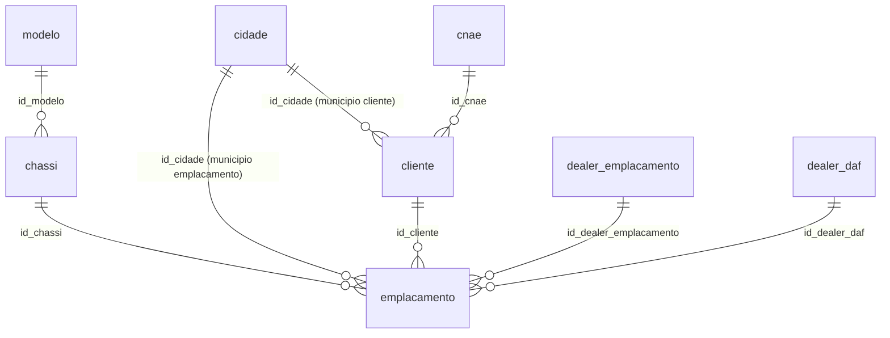

# Documentação do Schema do Banco de Dados (`docs/SCHEMA.md`)

Este documento descreve a estrutura física do banco SQLite local (`data/emplacamentos_synthetic.db`), extraída diretamente do DDL oficial ([scripts/schema.sql](file:///e:/testeChat/scripts/schema.sql)), em cumprimento à **Tarefa 1** e à **Seção 3** do [AGENTS.md](file:///e:/testeChat/AGENTS.md).

---

## 1. Visão Geral das Tabelas

O DDL define **10 tabelas** e **9 índices**:

| Tabela | Papel no Domínio | Volume de Referência (`AGENTS.md`) | Exposta na Camada Semântica? |
|---|---|---:|:---:|
| `modelo` | Catálogo de modelos de caminhões (ANFAVEA), fabricante e segmentação | 1.161 | Sim |
| `cidade` | Catálogo de municípios (IBGE), UF, coordenadas e mesorregião/microrregião | 5.573 | Sim |
| `chassi` | Registro de chassis novos fabricados e vinculados a um modelo | 776.701 | Sim |
| `emplacamento` | Fato de emplacamento de chassi novo (data, município do emplacamento, cliente, dealers) | 777.365 | Sim |
| `cliente` | Cadastro de clientes (PJ/PF) proprietários no emplacamento | 109.358 | Parcial (apenas vínculos agregados/geográficos; **sem PII**) |
| `dealer_daf` | Concessionárias da rede da montadora (`dealer_montadora` no `AGENTS.md`) | 215 | Sim |
| `dealer_emplacamento` | Concessionárias responsáveis pelo emplacamento multimarca | 1.237 | Sim |
| `cnae` | Catálogo de atividades econômicas (CNAE) | *(Auxiliar)* | Opcional (agregado por setor) |
| `cnpj_cnae` | Vínculo entre documento do cliente e CNAEs secundários/principal | *(Auxiliar)* | **Não** (contém documento individual) |
| `quadro_societario` | Sócios e representantes legais das empresas clientes | *(Auxiliar)* | **Não** (dados pessoais/sócios — bloqueado pela Seção 2 e 7) |

---

## 2. Detalhamento de Tabelas, Colunas e Chaves

### 2.1. `modelo`
Catálogo de modelos segundo nomenclatura ANFAVEA.
- **Chave Primária:** `id_modelo` (`INTEGER NOT NULL PRIMARY KEY`)
- **Colunas:**
  - `modelo` (`TEXT NOT NULL`) — Nome/código do modelo (ex.: `XF 530 6X4`, `FH 540`, `ACTROS 2651`). Contém variações de grafia para testes de robustez.
  - `fabricante` (`TEXT NOT NULL`) — Marca/fabricante (`AGRALE`, `DAF`, `IVECO`, `SCANIA`, `MERCEDEZ-BENZ`, `VOLVO`, `VOLKSWAGEN`).
  - `segmento` (`TEXT NOT NULL`) — Segmento principal (ex.: `PESADO`, `SEMI-PESADO`).
  - `subsegmento` (`TEXT NOT NULL`) — Subsegmentação de mercado/PBT.
  - `combustivel` (`TEXT NOT NULL`) — Tipo de combustível (ex.: `DIESEL`).
  - `potencia` (`TEXT`, nullable) — Faixa ou valor nominal de potência.
  - `tracao_anfavea` (`TEXT`, nullable) — Configuração de tração (ex.: `4X2`, `6X2`, `6X4`, `8X2`, `8X4`).
  - `segmento_anfavea` (`TEXT`, nullable) — Classificação oficial ANFAVEA.

### 2.2. `cidade`
Dimensão geográfica de municípios brasileiros.
- **Chave Primária:** `id_cidade` (`INTEGER NOT NULL PRIMARY KEY`)
- **Colunas:**
  - `nome_cidade` (`TEXT NOT NULL`) — Nome do município (inclui registros `"Não informado"` e grafias históricas/antigas).
  - `UF` (`TEXT`, nullable) — Sigla da Unidade Federativa (ex.: `SP`, `PR`, `MT`, ou `NI` / `NULL` para não informado).
  - `codigo_cidade` (`INTEGER`, nullable) — Código IBGE do município (7 dígitos).
  - `latitude` (`REAL`, nullable) — Latitude do município.
  - `longitude` (`REAL`, nullable) — Longitude do município.
  - `microrregiao` (`TEXT`, nullable) — Microrregião geográfica IBGE.
  - `mesorregiao` (`TEXT`, nullable) — Mesorregião geográfica IBGE.

### 2.3. `cnae`
Catálogo de Classificação Nacional de Atividades Econômicas.
- **Chave Primária:** `id_cnae` (`INTEGER NOT NULL PRIMARY KEY`)
- **Colunas:**
  - `nome_cnae` (`TEXT NOT NULL`) — Descrição da atividade econômica.

### 2.4. `dealer_daf` (correspondente a `dealer_montadora` na Seção 3 do `AGENTS.md`)
Cadastro das concessionárias da montadora DAF.
- **Chave Primária:** `id_dealer_daf` (`INTEGER NOT NULL PRIMARY KEY`)
- **Colunas:**
  - `nome_dealer` (`TEXT NOT NULL`) — Nome do grupo/concessionária.
  - `loja` (`TEXT`, nullable) — Identificação da filial/loja.

### 2.5. `dealer_emplacamento`
Cadastro de concessionárias multimarcas associadas ao emplacamento.
- **Chave Primária:** `id_dealer_emplacamento` (`INTEGER NOT NULL PRIMARY KEY`)
- **Colunas:**
  - `nome_dealer` (`TEXT NOT NULL`) — Razão social / nome do dealer.
  - `cnpj` (`TEXT`, nullable) — CNPJ do dealer.

### 2.6. `chassi`
Cadastro de chassis novos.
- **Chave Primária:** `id_chassi` (`INTEGER NOT NULL PRIMARY KEY`)
- **Chaves Estrangeiras:**
  - `id_modelo` (`INTEGER NOT NULL`) $\rightarrow$ `modelo(id_modelo)`
- **Colunas:**
  - `chassi` (`TEXT NOT NULL`) — Código VIN sintético do chassi.
  - `situacao_chassi` (`TEXT`, nullable) — Status do chassi (ex.: `EMPLACADO`, `ATIVO`).
  - `ano_modelo` (`INTEGER NOT NULL`) — Ano do modelo.
  - `ano_fabricacao` (`INTEGER NOT NULL`) — Ano de fabricação.
- **Índices:** `idx_chassi_modelo (id_modelo)`

### 2.7. `cliente`
Cadastro de clientes (compradores). **Nota de Privacidade (Seções 2 e 7):** Campos de identificação individual (`numero_documento`, `razao_social`, `nome_fantasia`, `endereco`, `email`, etc.) **nunca** são expostos na camada semântica nem enviados ao LLM.
- **Chave Primária:** `id_cliente` (`INTEGER NOT NULL PRIMARY KEY`)
- **Chaves Estrangeiras:**
  - `id_cidade` (`INTEGER NOT NULL`) $\rightarrow$ `cidade(id_cidade)` *(Município de domicílio do cliente — distinto do município de emplacamento!)*
  - `id_cnae` (`INTEGER`, nullable) $\rightarrow$ `cnae(id_cnae)`
- **Colunas:**
  - `numero_documento` (`TEXT NOT NULL`)
  - `tipo_pessoa` (`TEXT NOT NULL`)
  - `razao_social` (`TEXT NOT NULL`)
  - `nome_fantasia` (`TEXT`, nullable)
  - `endereco` (`TEXT NOT NULL`)
  - `complemento` (`TEXT`, nullable)
  - `bairro` (`TEXT`, nullable)
  - `email` (`TEXT NOT NULL`)
  - `natureza_juridica` (`TEXT`, nullable)
  - `cep` (`TEXT`, nullable)
  - `data_abertura` (`DATE`, nullable)
  - `situacao_empresa` (`TEXT`, nullable)
  - `data_situacao` (`DATE`, nullable)
  - `tipo_empresa` (`TEXT`, nullable)
  - `porte_empresa` (`TEXT`, nullable)
  - `ultima_atualizacao` (`DATE`, nullable)
  - `capital_social_empresa` (`DECIMAL(18, 2)`, nullable)
  - `numero_documento_valido` (`TEXT`, nullable)
- **Índices:** `idx_cliente_cidade (id_cidade)`, `idx_cliente_cnae (id_cnae)`

### 2.8. `emplacamento`
Tabela fato central de emplacamentos de veículos novos.
- **Chave Primária:** `id_emplacamento` (`INTEGER NOT NULL PRIMARY KEY`)
- **Chaves Estrangeiras:**
  - `id_chassi` (`INTEGER NOT NULL`) $\rightarrow$ `chassi(id_chassi)`
  - `id_cidade` (`INTEGER NOT NULL`) $\rightarrow$ `cidade(id_cidade)` *(Município onde ocorreu o emplacamento)*
  - `id_cliente` (`INTEGER NOT NULL`) $\rightarrow$ `cliente(id_cliente)`
  - `id_dealer_emplacamento` (`INTEGER NOT NULL`) $\rightarrow$ `dealer_emplacamento(id_dealer_emplacamento)`
  - `id_dealer_daf` (`INTEGER`, nullable) $\rightarrow$ `dealer_daf(id_dealer_daf)`
- **Colunas:**
  - `data_emplacamento` (`DATE NOT NULL`) — Data do emplacamento (`YYYY-MM-DD`).
  - `preco` (`NUMERIC(10, 2)`, nullable) — Valor registrado no emplacamento.
  - `preco_validado` (`TEXT`, nullable) — Indicador de validação do preço.
  - `data_atualizacao` (`DATE NOT NULL`) — Data de atualização do registro.
  - `placa` (`TEXT NOT NULL`) — Placa sintética do veículo (**não exposta na camada semântica**).
- **Índices:**
  - `idx_emplacamento_data (data_emplacamento)`
  - `idx_emplacamento_chassi (id_chassi)`
  - `idx_emplacamento_cidade (id_cidade)`
  - `idx_emplacamento_cliente (id_cliente)`
  - `idx_emplacamento_dealer (id_dealer_emplacamento)`
  - `idx_emplacamento_dealer_daf (id_dealer_daf)`

### 2.9. `cnpj_cnae` *(Tabela Auxiliar — Sem PK explícita no DDL)*
- **Colunas:** `numero_documento` (`TEXT NOT NULL`), `id_cnae` (`INTEGER NOT NULL`), `descricao_cnae` (`TEXT NOT NULL`), `principal` (`TEXT NOT NULL`).

### 2.10. `quadro_societario` *(Tabela Auxiliar — Sem PK explícita no DDL — Bloqueada por Privacidade)*
- **Colunas:** `numero_documento` (`TEXT NOT NULL`), `nome_socio` (`TEXT`), `qualificacao` (`TEXT`), `pais_origem` (`TEXT`), `nome_representante_legal` (`TEXT`), `qualificacao_representante_legal` (`TEXT`).

---

## 3. Diagrama de Entidade-Relacionamento (Mermaid)

---

## 4. Diferenças Observadas entre o `AGENTS.md` e o DDL Físico (`scripts/schema.sql`)

1. **Nomes das chaves com `_` (underscore):** No texto descritivo do `AGENTS.md` citava-se `idcliente` e `idcidade`; no DDL físico as colunas são `id_cliente`, `id_cidade`, `id_chassi`, `id_modelo`, `id_emplacamento`, `id_dealer_emplacamento`, `id_dealer_daf`.
2. **`dealer_montadora` vs. `dealer_daf`:** A tabela chamada `dealer_montadora` (215 linhas) no `AGENTS.md` chama-se fisicamente `dealer_daf` no DDL, e o relacionamento com `emplacamento` já está explícito via chave estrangeira `emplacamento.id_dealer_daf` (nullable) e `emplacamento.id_dealer_emplacamento` (`NOT NULL`).
3. **Tabelas extras no DDL:** O DDL inclui `cnae`, `cnpj_cnae` e `quadro_societario`. Conforme a **Seção 2 e 7** (privacidade e proibição de dados individuais/pessoas), `quadro_societario` e `cnpj_cnae` ficam fora da `allowlist` da camada semântica.
